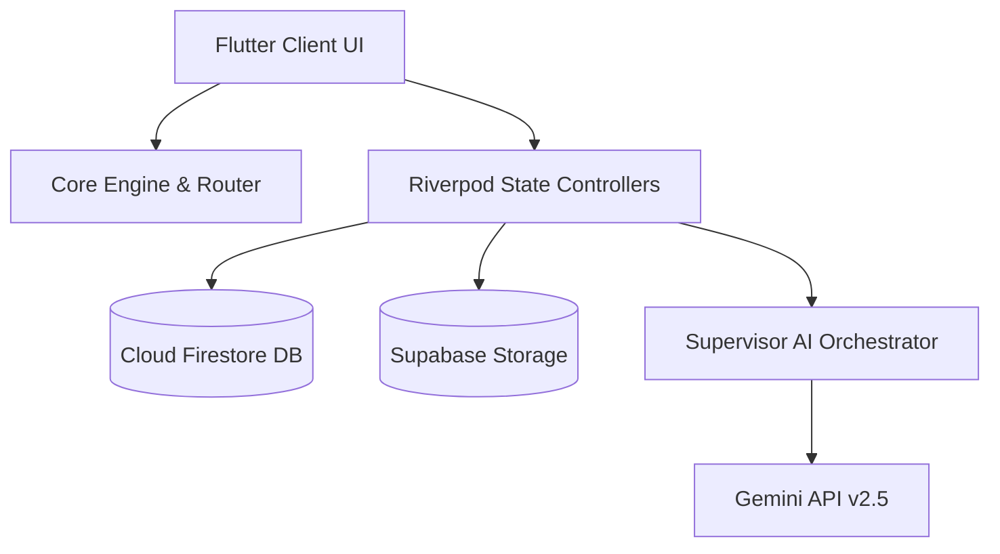

# HODS - Hostel Management & AI Recommendation Engine

HODS is an enterprise-grade solution for student hostel management, smart room allocations, real-time complaint tracking, compatibility-based roommate matching, and multi-agent AI recommendations.

---

## 🌟 Key Features

- **Multi-Role Dashboards**: Specific portal designs customized for Students, Hostel Owners, and System Administrators.
- **AI-Driven Recommendations**: Powered by a Multi-Agent framework utilizing `gemini-2.5-flash` with dynamic reflection and self-verification features.
- **Interactive Thinking Timeline**: Displays real-time agent execution processes similar to advanced LLM frontends.
- **Roommate Matching**: Uses a compatibility algorithm based on sleep hours, study preferences, cleanliness, and lifestyle preferences.
- **Swipe-to-Dismiss Alerts**: Real-time Firestore notification center with intuitive swiping gestures to clear messages.

---

## 🏗️ System Architecture



### Modules:
- `lib/core`: Routing configurations (`app_router.dart`), themes, and app-wide constants.
- `lib/features`: Role-specific directories containing view models and screens.
- `lib/services`: Integrations with Firestore database, Supabase image manager, and AI engines.

---

## 🤖 AI Capabilities & Multi-Agent Framework

HODS decouples reasoning into specialized cooperative agents:
- **SupervisorAgent**: Coordinates specialists and delegates tasks dynamically.
- **Specialists**: Focus on domain-specific logic (Booking, Planning, RAG Knowledge, Complaints, Analytics).
- **ReflectionAgent**: Reviews responses, checks constraints, and fixes issues before generating responses.

---

## 🛠️ Installation & Firebase Configuration

### Prerequisites
- **Flutter SDK**: `>=3.0.0`
- **Dart SDK**: `>=3.0.0`
- **Firebase CLI**: Logged in and configured.

### Local Setup
1. **Clone & Setup**:
   ```bash
   git clone <repository_url>
   cd fyp1
   flutter pub get
   ```
2. **Setup Firebase**:
   - Run `flutterfire configure` to generate `firebase_options.dart`.
   - Enable **Email/Password** authentication in the Firebase Console.
   - Upload [firestore.rules](file:///d:/fyp1/firestore.rules) to enforce data security.

3. **Launch**:
   ```bash
   flutter run
   ```

---

## 🧪 Testing Instructions

HODS has a suite of widget and unit tests:

### Run Unit Tests:
```bash
flutter test
```

### Static Code Validation:
```bash
flutter analyze
```

---

## 📦 Deployment Guide

Refer to the [deployment_guide.md](file:///C:/Users/User/.gemini/antigravity-ide/brain/22d49918-d121-4056-a403-28d711268af7/deployment_guide.md) for signing details and compiling release builds:
```bash
flutter build apk --release
```

---

## 👥 Contributors
- **FYP Candidate**: Software Engineer & Lead Mobile developer.
- **Supervisor**: Academic Mentor & Evaluator.
=======
# HODS
A mobile based application for booking hostels
>>>>>>> 035c74bed5becd90985f98a371ef6b5171d69673
